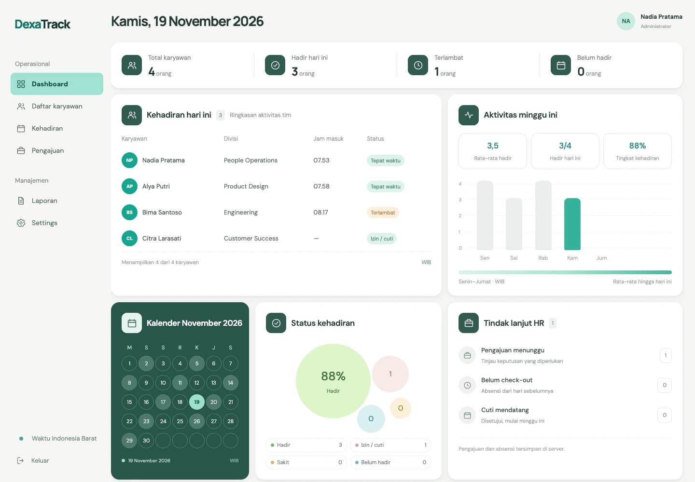
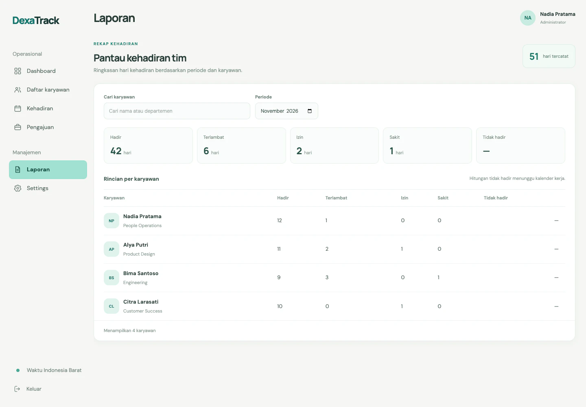
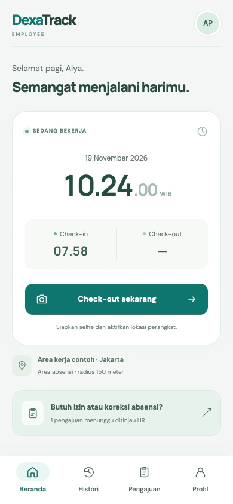

<h1 align="center">
  
</h1>

<p align="center"><strong>Absensi kerja jarak jauh dan pengelolaan kehadiran tim</strong></p>

<p align="center">
  <a href="apps/web/ARCHITECTURE.md"></a>
  <a href="docs/technical-guide.md"></a>
  <a href="docs/database-design.md"></a>
  <a href="LICENSE"></a>
</p>

<p align="center">
  <a href="#tampilan-aplikasi">Tampilan aplikasi</a> ·
  <a href="#menjalankan-secara-lokal">Instalasi lokal</a> ·
  <a href="docs/README.md">Dokumentasi per menu</a> ·
  <a href="#kustomisasi-untuk-bisnis">Kustomisasi untuk bisnis</a>
</p>

DexaTrack membantu karyawan melakukan check-in dan check-out dengan selfie dan GPS, mencatat progres kerja, serta mengajukan cuti, sakit, izin, atau koreksi absensi. Admin HR dapat memantau kehadiran harian, meninjau pengajuan, mengelola akun, dan melihat rekap bulanan. Lokasi, radius absensi, dan jam masuk WIB dapat diatur dari aplikasi.

## Tampilan aplikasi

Data pada screenshot bersifat fiktif. Panduan tiap menu memuat tampilan desktop dan HP.

| [Dashboard HR](docs/hr-dashboard.md) | [Laporan bulanan](docs/hr-laporan.md) | [Beranda karyawan](docs/karyawan-beranda.md) |
| :---: | :---: | :---: |
| <a href="docs/hr-dashboard.md"></a> | <a href="docs/hr-laporan.md"></a> | <a href="docs/karyawan-beranda.md"></a> |

## Dokumentasi

- [Indeks panduan pengguna](docs/README.md) mencakup menu admin HR, portal karyawan, dan halaman akun.
- [Panduan teknis](docs/technical-guide.md) menjelaskan konfigurasi, migrasi, autentikasi, kontrak HTTP, dan pengujian.
- [Desain database](docs/database-design.md) menjelaskan skema dan kepemilikan data setiap layanan.

## Menjalankan secara lokal

Siapkan Node.js 20.19+ atau 22.12+, npm, dan Docker Compose. Jalankan perintah dari root repository. Jika memakai database yang sudah berisi data, ikuti [prosedur migrasi database yang sudah ada](docs/technical-guide.md#migrasi-database-yang-sudah-ada) sebelum menerapkan migrasi.

1. Salin konfigurasi contoh.

   ```sh
   cp .env.example .env
   for app in api-gateway auth-service employees-service attendance-service; do
     cp "apps/$app/.env.example" "apps/$app/.env"
   done
   ```

   Isi `DEXATRACK_DB_PASSWORD` di `.env` root dan sesuaikan password pada `DATABASE_URL` di setiap layanan pemilik database.

2. Nyalakan MySQL dan Mailpit, lalu tunggu MySQL berstatus sehat pada `docker compose ps`.

   ```sh
   docker compose up -d
   docker compose ps
   npm ci
   npm run db:generate
   ```

3. Terapkan migrasi untuk database lokal yang baru.

   ```sh
   npm exec -w @dexatrack/auth-service -- prisma migrate deploy
   npm exec -w @dexatrack/employees-service -- prisma migrate deploy
   npm exec -w @dexatrack/attendance-service -- prisma migrate deploy
   ```

4. Jalankan masing-masing perintah di terminal terpisah.

   ```sh
   npm run dev:employees
   npm run dev:auth
   npm run dev:attendance
   npm run dev:gateway
   npm run dev:web
   ```

5. Buat akun admin HR pertama, lalu masuk melalui [localhost:5173](http://localhost:5173).

   ```sh
   npm run bootstrap -w @dexatrack/auth-service
   ```

Gateway tersedia di [localhost:3000/api](http://localhost:3000/api) dan email pengujian masuk ke [Mailpit](http://localhost:8025) pada konfigurasi bawaan. Untuk menguji absensi, atur lokasi kerja di **Settings** dan gunakan akun karyawan yang sudah aktif. Kamera dan GPS membutuhkan izin browser serta akses melalui HTTPS tepercaya atau localhost.

## Arsitektur

| Workspace | Tanggung jawab |
| --- | --- |
| `apps/web` | Aplikasi React, TypeScript, dan Vite untuk HR dan karyawan |
| `apps/api-gateway` | API HTTP dan komunikasi TCP ke layanan NestJS |
| `apps/auth-service` | Akun, persetujuan, sesi, dan pemulihan password |
| `apps/employees-service` | Profil karyawan dan identitas kepegawaian |
| `apps/attendance-service` | Absensi, bukti selfie, pengajuan, pengaturan kerja, dan laporan |

## Lisensi

DexaTrack menggunakan lisensi MIT. Siapa pun boleh melakukan fork, memodifikasi, dan menggunakan DexaTrack untuk kebutuhan bisnis, termasuk penggunaan komersial. Sertakan pemberitahuan hak cipta dan teks lisensi pada salinan atau bagian substansial dari kode. [Baca lisensi MIT](LICENSE).

## Kustomisasi untuk bisnis

Butuh alur absensi, pengajuan, atau laporan yang sesuai dengan proses kerja di bisnis Anda? Kami bisa membantu menyesuaikan DexaTrack dengan kebutuhan tim Anda.

Ceritakan kebutuhan Anda kepada kami melalui [WhatsApp +62 81513335320](https://wa.me/6281513335320) atau [virya.brightly@gmail.com](mailto:virya.brightly@gmail.com).
