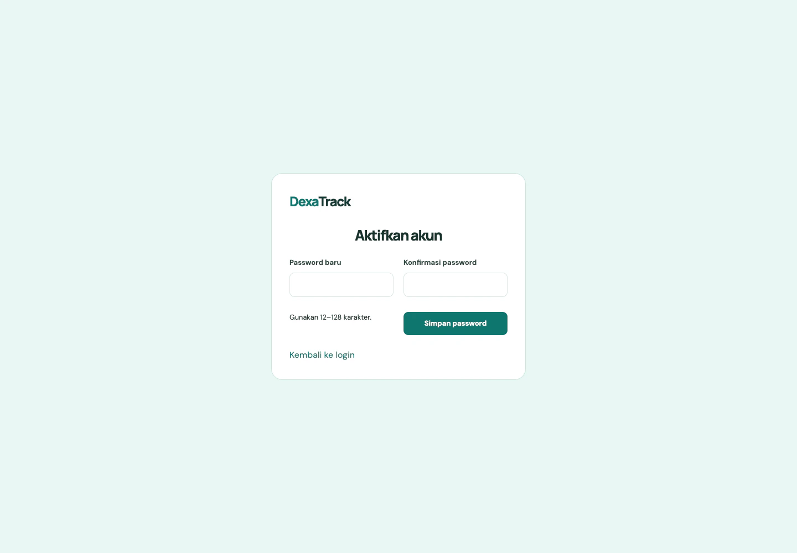
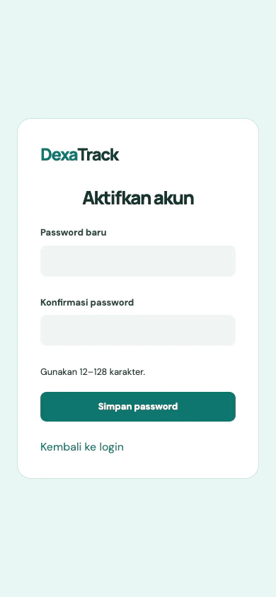

# Aktivasi akun

[← Indeks dokumentasi](README.md) · `/activate` · Akses dan keamanan akun

Gunakan tautan aktivasi dari email untuk mengatur password pada akun yang dibuat HR.

- Buka tautan dari email, masukkan password 12–128 karakter dan konfirmasinya, lalu simpan.
- Tautan aktivasi berlaku sekali pakai selama 30 menit. Hubungi HR untuk meminta pengiriman ulang jika tautan kedaluwarsa.

## Desktop

## HP

