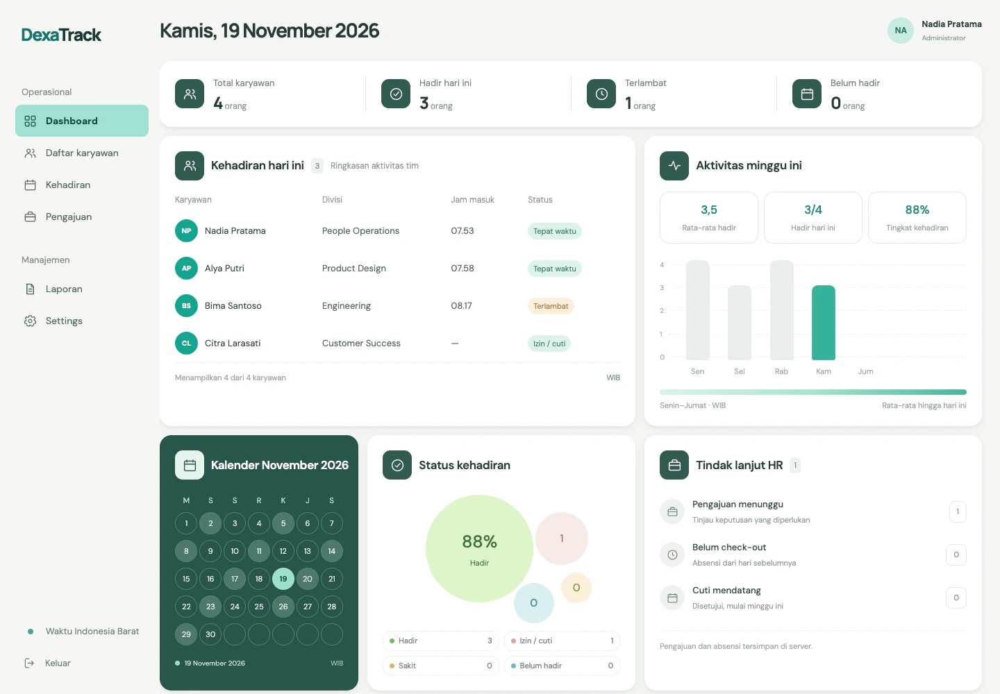
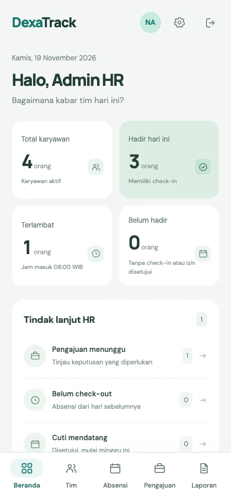

# Dashboard

[← Indeks dokumentasi](README.md) · `/dashboard` · Admin HR

Pantau kondisi kehadiran tim hari ini dan lihat hal yang perlu ditindaklanjuti.

- Lihat jumlah karyawan aktif, karyawan yang sudah check-in, keterlambatan, dan karyawan yang belum hadir.
- Pilih item di **Tindak lanjut HR** untuk membuka pengajuan menunggu, absensi tanpa check-out dari hari sebelumnya, atau cuti yang disetujui dan mulai minggu ini.
- Gunakan daftar kehadiran, grafik aktivitas mingguan, dan kalender untuk memberi konteks pada ringkasan harian.

## Desktop

## HP

