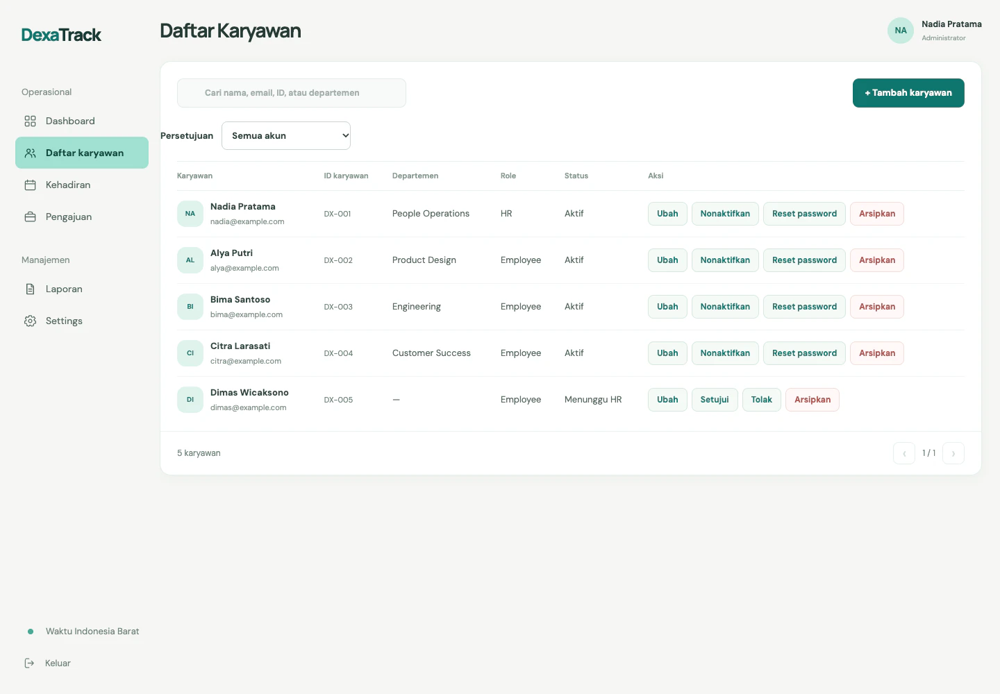
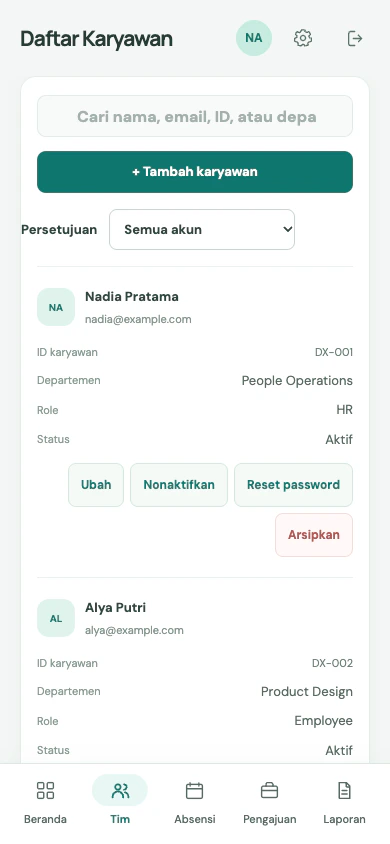

# Daftar karyawan

[← Indeks dokumentasi](README.md) · `/karyawan` · Admin HR

Kelola profil, status, dan akses akun karyawan. Di HP, menu ini bernama **Tim**.

- Cari berdasarkan nama, email, ID, atau departemen. Filter **Persetujuan** membantu menemukan akun yang perlu ditinjau.
- Setujui atau tolak pendaftaran mandiri. Saat menyetujui akun, tetapkan departemen karyawan.
- Tambahkan karyawan untuk mengirim tautan aktivasi. Dari daftar yang sama, HR dapat mengubah akun, menonaktifkan akses, mengirim tautan reset atau aktivasi ulang, dan mengarsipkan akun.

## Desktop

## HP

