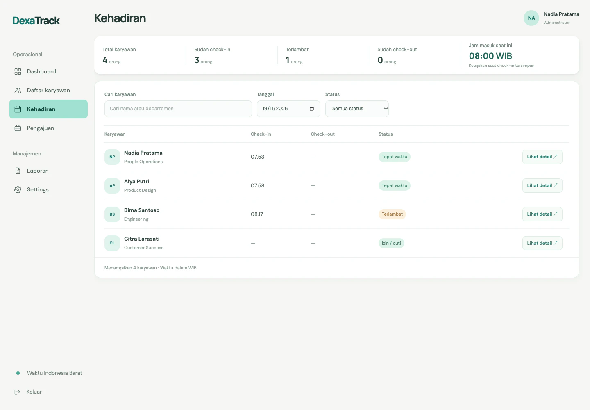
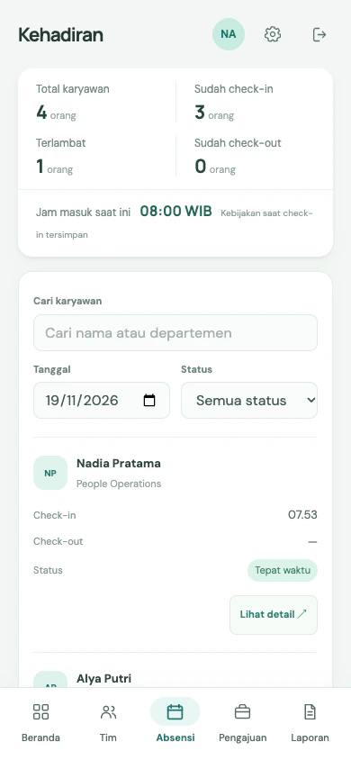

# Kehadiran

[← Indeks dokumentasi](README.md) · `/kehadiran` · Admin HR

Periksa absensi karyawan pada tanggal tertentu. Di HP, menu ini bernama **Absensi**.

- Pilih tanggal, lalu gunakan pencarian nama atau departemen dan filter status untuk mempersempit daftar.
- Buka **Lihat detail** untuk memeriksa jam masuk dan pulang, selfie, lokasi, progres kerja, serta riwayat koreksi jika tersedia.
- Jam ditampilkan dalam WIB. Penentuan keterlambatan memakai jam masuk yang tersimpan saat check-in.

## Desktop

## HP

