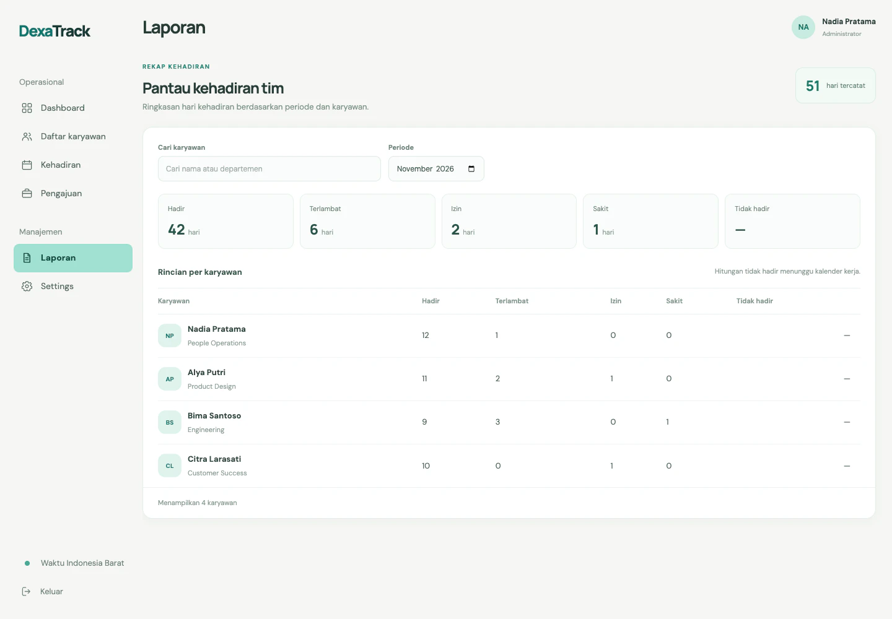
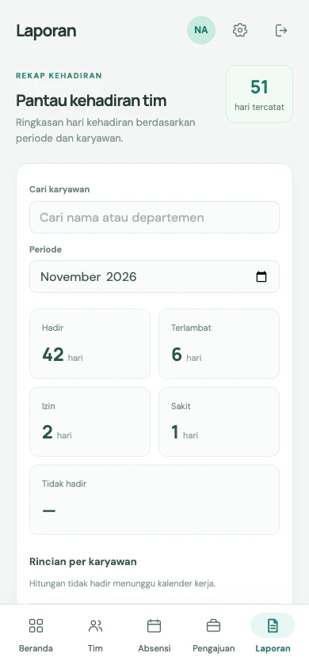

# Laporan

[← Indeks dokumentasi](README.md) · `/laporan` · Admin HR

Lihat rekap kehadiran bulanan untuk tim dan rincian per karyawan.

- Pilih **Periode** untuk mengganti bulan. Gunakan kolom pencarian untuk memfilter nama atau departemen.
- Setiap tanggal dihitung satu kali per karyawan. Check-in tepat waktu masuk kategori **Hadir**, check-in setelah jam masuk tercatat sebagai **Terlambat**, dan cuti yang disetujui masuk kategori **Izin**.
- Izin, cuti, dan sakit yang disetujui dihitung sampai hari ini WIB. Kolom **Tidak hadir** menampilkan tanda pisah sampai kalender kerja tersedia.

## Desktop

## HP

