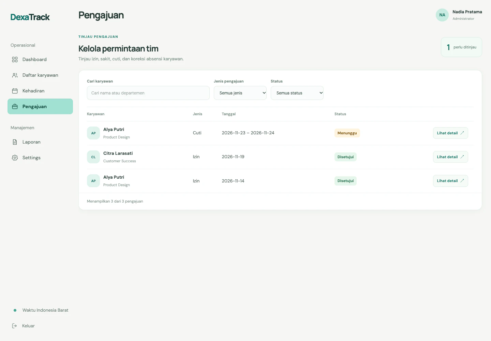
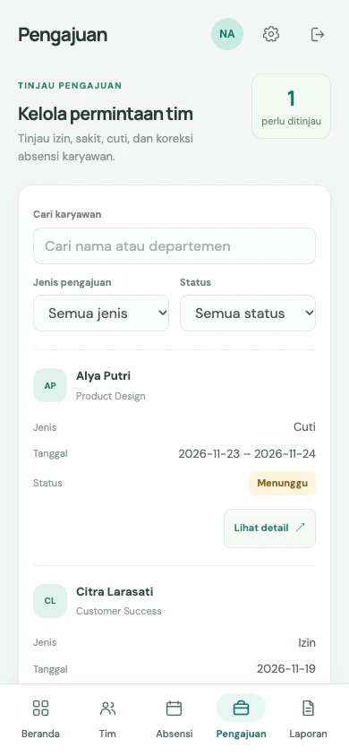

# Pengajuan HR

[← Indeks dokumentasi](README.md) · `/pengajuan` · Admin HR

Tinjau permintaan cuti, sakit, izin, dan koreksi absensi dari karyawan.

- Gunakan filter **Jenis pengajuan** dan **Status**, atau cari berdasarkan nama dan departemen.
- Buka **Lihat detail** untuk membaca alasan, tanggal, dan usulan jam jika pengajuan berupa koreksi absensi.
- Pilih **Setujui** atau **Tolak** pada pengajuan berstatus **Menunggu**. Status keputusan tampil di portal karyawan.

## Desktop

## HP

