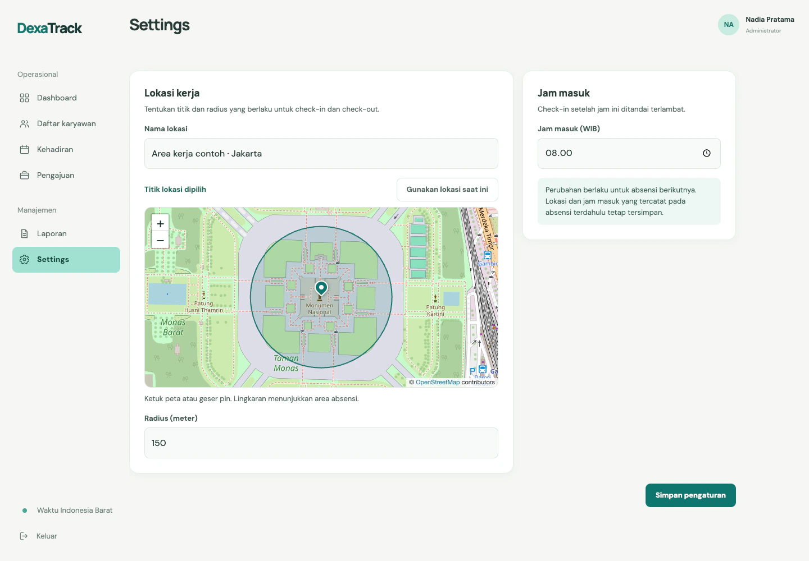
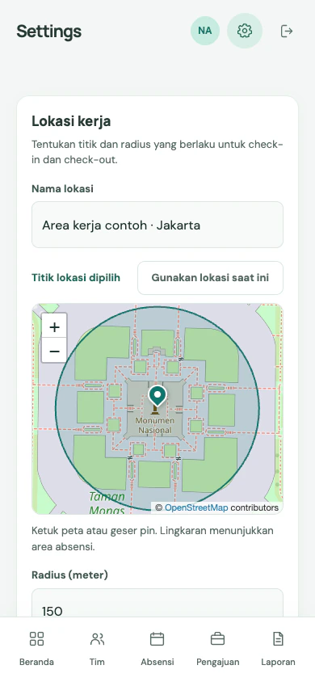

# Settings

[← Indeks dokumentasi](README.md) · `/settings` · Admin HR

Atur titik GPS, radius, dan jam masuk yang dipakai ketika karyawan melakukan absensi.

- Beri nama lokasi kerja, lalu ketuk peta, geser pin, atau gunakan lokasi perangkat untuk menentukan titik pusat.
- Masukkan radius dalam meter. Lingkaran pada peta menunjukkan area yang berlaku untuk check-in dan check-out.
- Atur **Jam masuk** dalam WIB lalu simpan. Kebijakan yang tersimpan pada catatan absensi sebelumnya tetap menjadi acuan untuk catatan tersebut.

## Desktop

## HP

