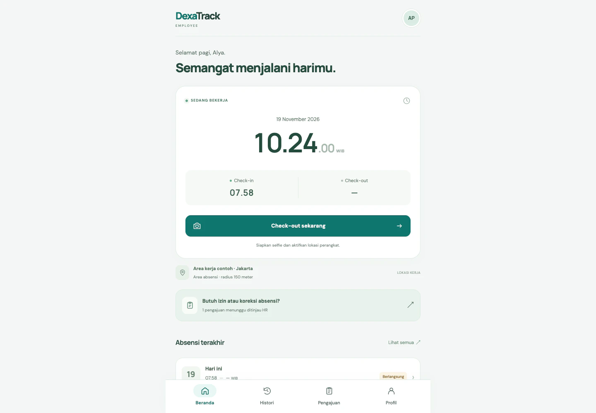
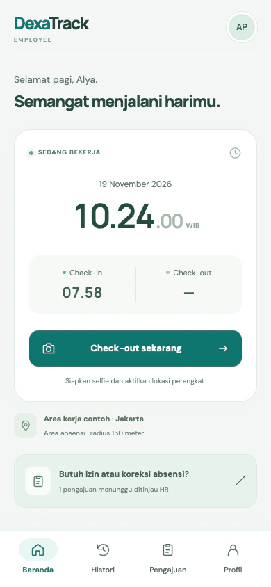

# Beranda karyawan

[← Indeks dokumentasi](README.md) · `/employee` · Portal karyawan

Mulai dan akhiri hari kerja dari satu layar. Kartu absensi menampilkan jam WIB, status hari ini, dan jam masuk serta pulang.

- Pilih **Check-in sekarang** saat mulai bekerja atau **Check-out sekarang** saat selesai. Izinkan kamera dan lokasi pada browser.
- Ambil selfie, pastikan perangkat berada di area yang ditetapkan HR, lalu kirim absensi. Isi progres kerja pada alur check-out.
- Buka **Histori** dari daftar absensi terakhir atau pilih pintasan pengajuan saat perlu izin atau koreksi.

## Desktop

## HP

