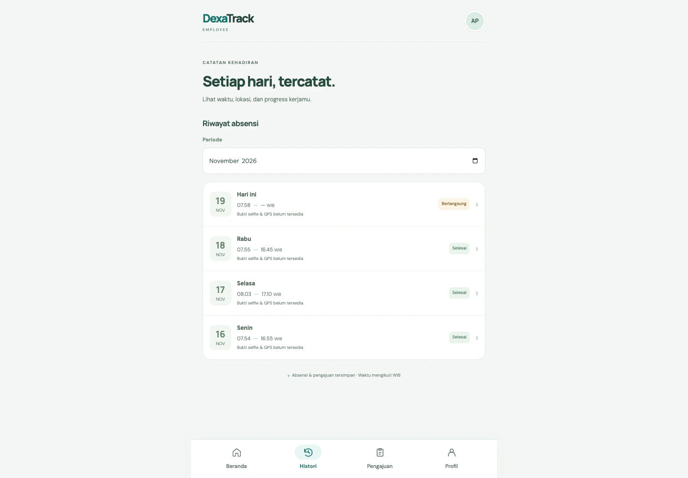
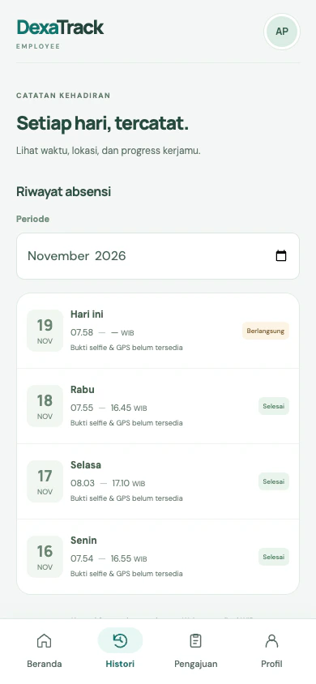

# Histori

[← Indeks dokumentasi](README.md) · `/employee/histori` · Portal karyawan

Lihat catatan absensi pribadi berdasarkan bulan.

- Pilih **Periode** untuk menampilkan catatan pada bulan tertentu.
- Pilih catatan untuk melihat jam masuk dan pulang, bukti lokasi dan selfie, progres kerja, serta koreksi HR jika tersedia.
- Jika ada jam yang perlu diperbaiki, buat pengajuan **Koreksi absensi** melalui menu Pengajuan.

## Desktop

## HP

