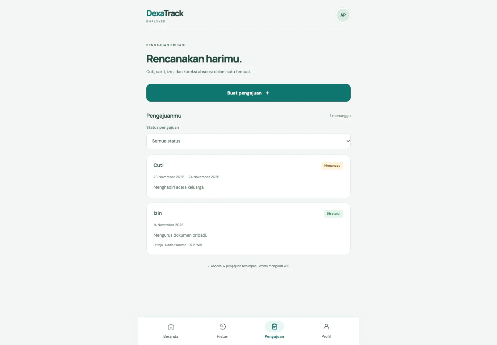
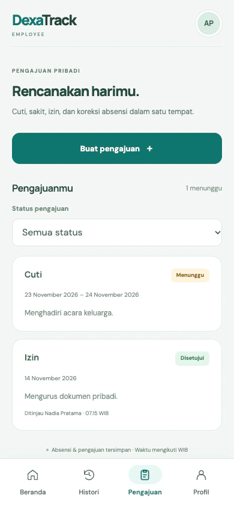

# Pengajuan karyawan

[← Indeks dokumentasi](README.md) · `/employee/pengajuan` · Portal karyawan

Ajukan cuti, sakit, izin, atau koreksi absensi, lalu pantau hasil peninjauan HR.

- Pilih **Buat pengajuan**, tentukan jenis dan tanggal, lalu isi alasan. Untuk koreksi, masukkan jam check-in atau check-out yang diusulkan.
- Setelah dikirim, pengajuan berstatus **Menunggu** dan masuk ke daftar tinjauan HR.
- Gunakan filter status untuk melihat pengajuan yang menunggu, disetujui, atau ditolak.

## Desktop

## HP

