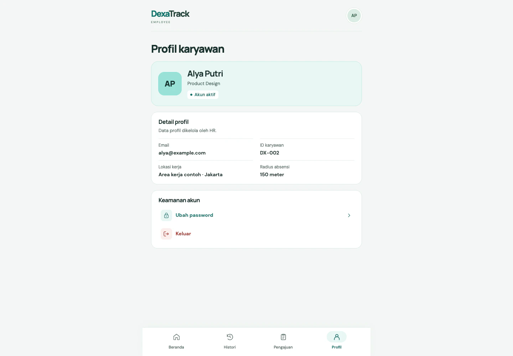
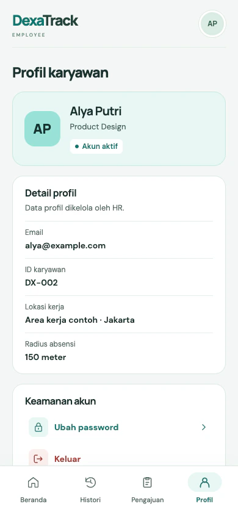

# Profil

[← Indeks dokumentasi](README.md) · `/employee/profil` · Portal karyawan

Lihat identitas akun, departemen, ID karyawan, status akses, dan area kerja yang ditetapkan HR.

- Hubungi HR untuk memperbarui identitas atau departemen.
- Pilih **Ubah password** untuk membuka [Keamanan akun](keamanan-akun.md). Pilih **Keluar** untuk mengakhiri sesi.

## Desktop

## HP

