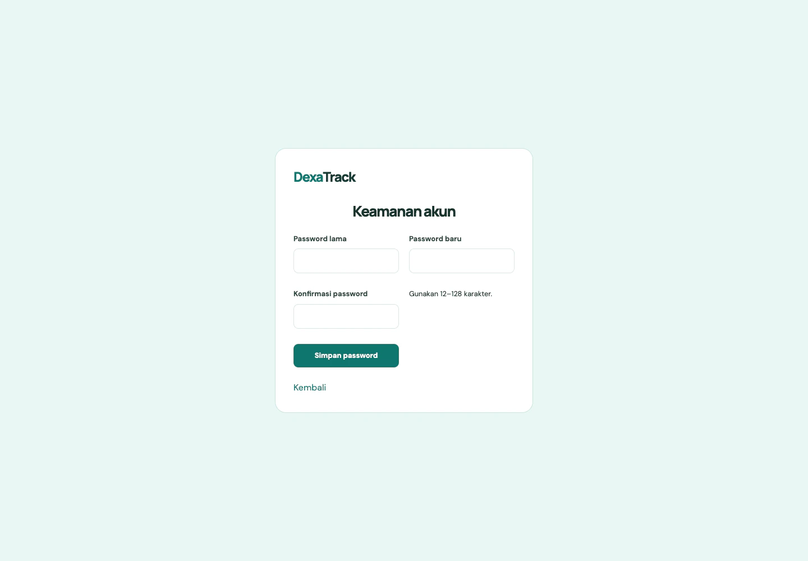
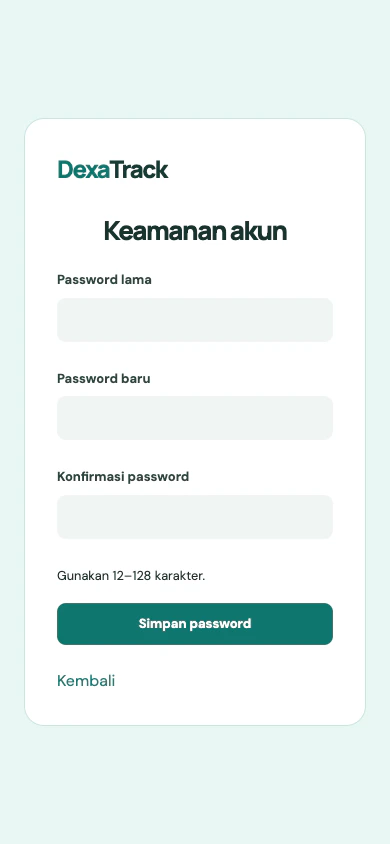

# Keamanan akun

[← Indeks dokumentasi](README.md) · `/account` · Akses dan keamanan akun

Ubah password ketika sudah masuk. Admin HR dapat membuka halaman ini dari avatar di header. Karyawan dapat membukanya dari Profil.

- Masukkan password saat ini, password baru 12–128 karakter, dan konfirmasi password baru.
- Setelah password tersimpan, sesi akun berakhir. Masuk kembali dengan password baru.

## Desktop

## HP

