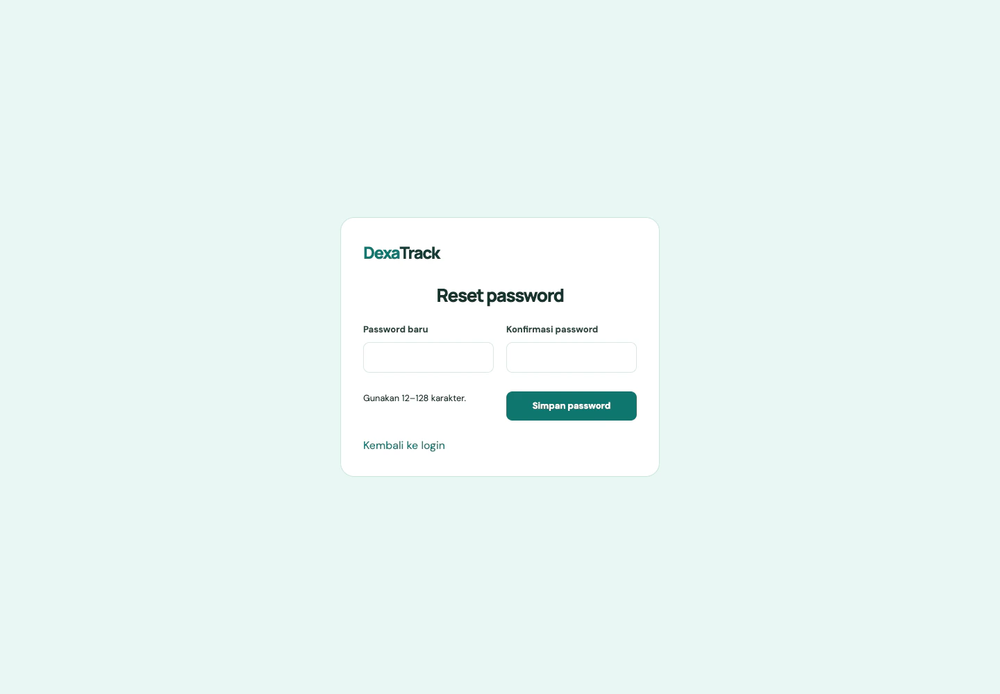
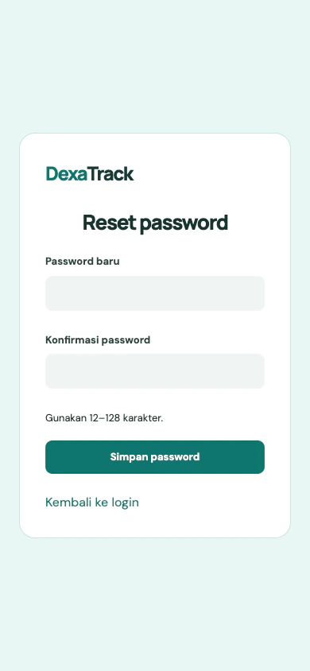

# Reset password

[← Indeks dokumentasi](README.md) · `/reset-password` · Akses dan keamanan akun

Atur password baru melalui tautan reset yang dikirim ke email.

- Buka tautan terbaru, isi password baru 12–128 karakter beserta konfirmasinya, lalu pilih **Simpan password**.
- Masuk kembali dengan password baru. Jika tautan kedaluwarsa, minta tautan baru dari halaman Lupa password atau hubungi HR.

## Desktop

## HP

